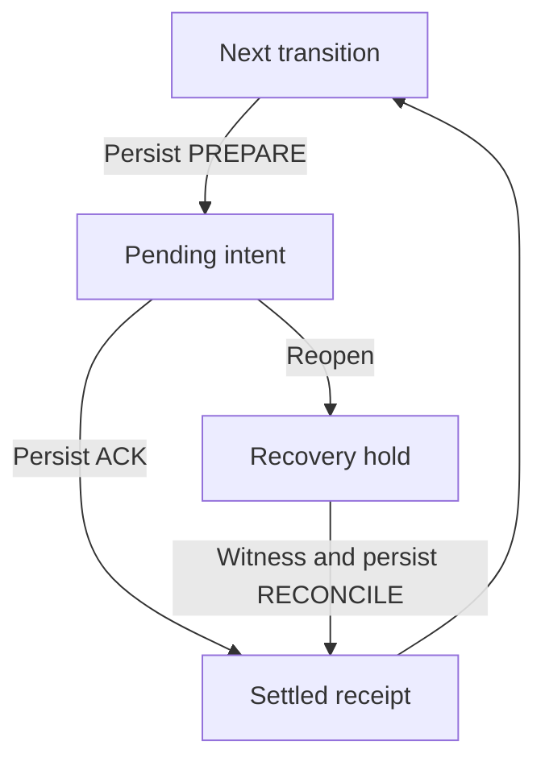

# C14-01 delivery-core acceptance record

Ticket: [#233](https://github.com/dylandlr/hearthbound/issues/233)
Draft implementation: [PR #234](https://github.com/dylandlr/hearthbound/pull/234)
Baseline: `a072519518db1458e8cb5aa1898aebd4ba93f03a` on `feat/renewable-village-economy-v0-23`.

**C14-01 remains open.** This change implements the delivery and persistence core. There is no
production runtime registration, native disruption adapter, actor observation feed, or learned response
in this change. Build compatibility and live acceptance are distinct gates.

## Mission and design decisions

The purpose of disruptions is to test the colony's own response to changed conditions. The scheduler
must not assign a replacement specialist, dictate recovery, expose future shocks to citizens, or award
learning credit simply because an event was scheduled. Job specialization remains a separate milestone
requiring persistent, grounded behavior and controlled evaluation.

The [version 2 contract](C14_EVENT_SCHEDULER_CONTRACT.md) replaces the v1 cursor-only snapshot. A cursor
cannot tell whether a physical mutation happened before a crash. Version 2 therefore records an intent
before handing it to an adapter and records a receipt before moving to the next transition. It holds
unsettled intents after restart for independent reconciliation. Old cursor snapshots are not silently
promoted to evidence.



An uncertain write halts the handle. A torn or invalid journal prevents reopening. The diagram's
reopen path requires a valid journal; it does not imply automatic repair of damaged evidence.

Key decisions are deterministic order, immutable schedules and views, world/run-bound receipt
identity, explicit missed-tick handling, bounded journal capacity with settlement reserve, and one
outstanding intent. This last choice makes delivery order and uncertainty clear; a held intent blocks
later delivery. Higher-throughput concurrent dispatch is a separate design change, not an implicit
property of this implementation.

## Ticket phases

| Phase | Work and evidence | Gate |
| --- | --- | --- |
| Requirements | Issue #233 mapped below; no-shock, overlap, skipped-tick, and restart semantics are explicit | Core scope specified |
| Design | Versioned wire contract, delivery state machine, binding and persistence limits | Core design implemented |
| Test design | Fixed oracles, malformed and impossible histories, actual process kills, writer contention, and cross-language fixtures | Executable cases present |
| Implementation | Python reference and pure Java 17-targeted implementation; no Forge dependencies in the core | Source present |
| Review | Independent QA and separate correctness review; concrete findings and fixes below | Core reviewed; native review pending |
| QA | Dedicated runner and CI retain logs, source/fixture hashes, command exit codes, and unexecuted stages | Inspect exact-head CI evidence in PR #234 |
| AI validation | No model or citizen policy changed | Not applicable to this core; adaptation gate remains open |
| Native validation | Full mod compilation uses existing Forge CI; physical scheduler operation is not wired | Live-world gate open |
| Integration | Isolated experiment package and draft PR; stacked baselines remain unmerged | Open |
| Acceptance | Requires native physical receipts, restart reconciliation, observation isolation, and controls | Ticket open |

## Acceptance-criteria mapping

| Issue criterion | Implemented evidence | Remaining condition |
| --- | --- | --- |
| Validate identity, type, timing, severity | Both event constructors; bounded count and signed-long times; overflow, NaN, boolean and identity tests | Native scenario configuration must preserve these constraints |
| Deterministic ordering and half-open intervals | End-before-start at shared ticks; ASCII ID order; fixed digest and transition oracles | Native adapter must respect interval semantics |
| Persist cursor and lifecycle without repeat delivery | Forced intent/receipt journal; pending recovery hold; exact receipt retry; killed-process tests | World save and journal are separate stores; reconcile physical evidence |
| Reject backward ticks and malformed state | Semantic replay plus sequence/hash checks; valid-checksum impossible-history tests; strict ASCII/LF format | Operational recovery for damaged journals remains explicit, never automatic |
| Keep future events private from actors | No actor/runtime integration exists in this change | Test information isolation after actual integration |
| Verify native effects and failures | Receipt API distinguishes APPLIED, FAILED, MISSED, and reconciled NOT_APPLIED | Adapter and independent world witnesses are still required |
| Overlap, skips, restart, invalid input, no-shock and compound tests | Python, Java and shared fixtures cover delivery behavior | Repeat these controls in disposable native worlds |
| Java/Python parity and Forge integration | Shared canonical digest, byte-identical journals and bidirectional replay; CI targets Java 17 | Full native adapter acceptance before closure |

## Executable validation

Run with a complete JDK 17 or later capable of targeting release 17 and Python 3.12:

```bash
python scripts/test-event-scheduler-contracts.py --evidence-dir event-scheduler-evidence
```

The runner uses `javac --release 17`, runs the Java contract groups, and runs Python behavioral and
cross-language tests. Its manifest pins the Git commit, working-tree state, input hashes, versions,
commands, stage outcomes, and explicit false flags for Forge execution, native physical effects, and
learned adaptation. Logs and the manifest are uploaded even when CI fails. No failed attempt is silently
retried or converted into a pass. The PR's exact-head workflow run and artifact are the current evidence;
this document does not freeze a potentially stale green status.

Local development initially had a slim Java 21 runtime without the Java 17 release symbols. Functional
checks on that runtime are useful, but are not Java 17 target evidence. The strict runner retained that
compilation failure rather than dropping the release flag; CI supplies a complete JDK 17.

The process-kill test uses a synthetic durable counter as a witness. It kills the process before intent,
after intent, after the synthetic effect, and after the receipt. This tests recovery behavior and must
not be described as a native Minecraft crash test or a power-loss experiment.

## Review findings resolved in this change

| Finding | Correction and regression |
| --- | --- |
| Cursor advanced before effect acknowledgement | Durable PREPARE plus separate settlement; restart holds unresolved intent |
| Receipt identity could collide across identical schedules in different runs | Runtime IDs include world and run; foreign receipt rejection |
| Last capacity slot could admit an intent that could never be settled | PREPARE reserves a receipt record and a maximum-sized receipt frame; boundary tests in both languages |
| Inherited Python handle could write after fork without owning the parent lock | PID rejection before inherited mutex acquisition; fork misuse regression |
| Python accepted bare CR between frames while Java rejected it | Strict printable ASCII/TAB/LF validation; shared bare-CR rejection case |
| Another same-process open could drop a POSIX file lock when closed | Inode guard before opening scheduler handles; hard-link and cross-process regression; raw-descriptor limitation documented |
| Full timeline scan on every advance | Indexed next transition; bounded immutable timeline |

## Native integration work still required

The first physical adapter should be a deliberately bounded crop disruption in a disposable test world.
Before touching blocks, define a versioned target descriptor and target digest, a fresh world/run binding,
the permitted fixture region, authoritative preconditions, and a separate physical witness. The current
event schema identifies kind/timing/severity; it does **not** yet pin native positions or dimensions.
Those physical targets must be included in a versioned binding before runtime promotion.

The adapter must check the current server tick, act on the server thread, record actual effects, and
keep unloaded or ambiguous evidence unresolved. It must not retry a potentially applied operation after
restart or infer an effect from the schedule alone. Define end-event handling for every start outcome:
APPLIED, FAILED (possibly partial mutation), MISSED, and NOT_APPLIED. No generic end transition restores
inventories or crops automatically.

Then run no-shock, on-time, missed, overlapping, and compound scenarios; include restart before/after
physical mutation and acknowledgement. Prove that future event specifications cannot enter citizen
observations, messages, rewards, or learner state. Only after physical controls pass should the separate
adaptation and specialization protocols evaluate recovery, reassignment, and occupational persistence.

The source-to-decision record is [C14_EVENT_SCHEDULER_REFERENCES.md](C14_EVENT_SCHEDULER_REFERENCES.md).
Sources motivate lifecycle and evaluation distinctions; they do not supply Hearthbound performance
results or replace these engineering gates.
